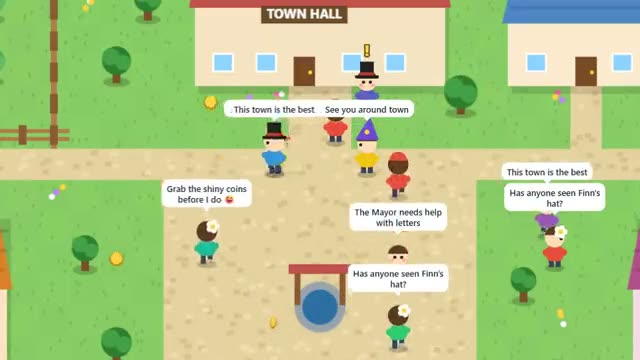

# Tiny MMO Town

A small town that remembers you. A multiplayer starter game from [Multiplayer Agent](https://multiplayeragent.com): 2D, drop-in, 2–30 players, with villager bots that walk about.

## How it plays

Walk around town, chat, help the villagers with three little quests and race other players to the shiny coins. Spend coins on hats and shirts at the tailor. Your coins, outfit and quests are saved, and you can save your character to play on any device.

**Controls:** Click or tap to walk (or WASD), tap someone to talk, type to chat.

## Make it yours in the Game Builder

Open the [Game Builder](https://multiplayeragent.com), choose **Start from a starter game** and pick Tiny MMO Town. It opens as version 1 in your studio, ready to play and publish. Then ask for changes, for example:

- Add fishing at the pond
- Add a market where players trade
- Add a weekend event with a reward

## Run it yourself

1. Get a free publishable key (`pk_…`) at [multiplayeragent.com](https://multiplayeragent.com).
2. In `index.html`, put it in place of `pk_REPLACE_ME` in the `MP_CONNECT` block.
3. Open `index.html` in a browser. No build step and no server needed.

Without a key it still runs, offline with the villagers, and saves on your device.

## How it is built

- One `index.html`. The comment at the top of the script maps the code and explains the multiplayer.
- The town is the text map in `CONFIG.map`; buildings, villagers with quests, the quests themselves and the shop's prices are plain lists in `CONFIG`.
- **Saves:** Your coins, outfit, quests and spot in town are saved for next time.
- **Player logins:** Anonymous at first; save your character with a username and password and log in on another device.
- **Leaderboard:** The most coins earned.
- **Bots:** Villagers walk about, chat and grab coins until people arrive.
- **Host-run rules:** The host's browser drops the coins and decides who got each one; if it leaves, the next player takes over.
- **Live ops:** Change how much a coin is worth (`coinValue`) or show an event without touching the code.
- `?attract` runs it offline with bots only. The preview video is recorded from it.

## License

MIT.
